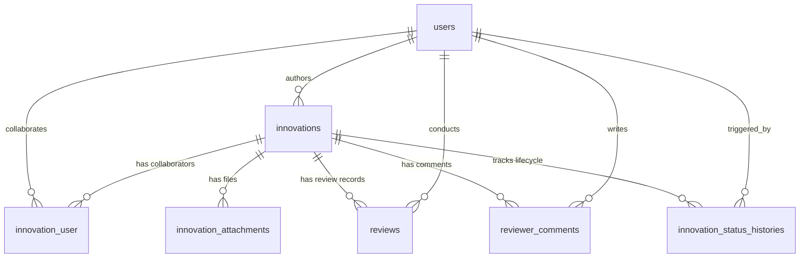

# Technical Specification: KSG Innovation Portal

## 1. Project Overview & Objectives
The **Kenya School of Government (KSG) Innovation Portal** is a collaborative web platform designed to collect, review, refine, and approve institutional innovation ideas submitted by staff and stakeholders.

---

## 2. Technology Stack & Architecture
- **Framework**: PHP Laravel 11.x (or latest stable)
- **Authentication**: Laravel Breeze (Blade + Tailwind CSS stack)
- **Authorization & RBAC**: Spatie Laravel-Permission
- **Frontend / Templating**: Blade Templates, Tailwind CSS, Alpine.js
- **Database**: MySQL 8.x
- **File Storage**: Laravel Storage (`storage/app/public` with symbolic link `public/storage`)
- **Architecture Pattern**: Lean Controllers + Dedicated Services/Actions + Form Requests (Validation) + Policies (Authorization)

---

## 3. User Roles & Permissions

| Role | Description | Core Capabilities |
| :--- | :--- | :--- |
| **Innovator** | Staff member or researcher submitting an idea | - Create/edit draft innovations<br>- Attach supporting files (PDF, DOCX, PNG, JPG, etc.)<br>- Add other registered users as co-innovator collaborators<br>- Submit innovation for review<br>- Revise and resubmit when `revision_requested` |
| **Reviewer** | Subject matter expert or evaluation committee member | - Access Reviewer Dashboard<br>- View innovations with status `submitted` or `under_review`<br>- Post internal reviewer comments (visible to fellow reviewers)<br>- Score/rate innovation (1 to 5 scale)<br>- Issue review decisions: `approved`, `rejected`, or `revision_requested` (with feedback) |
| **Admin** | System and portal administrator | - User management & role assignment<br>- System-wide reporting and metrics<br>- Portal configuration and category/tag management<br>- Oversight of all innovation records |

---

## 4. Innovation Lifecycle & State Machine

```
               [ Create Draft ]
                      │
                      ▼
                  ┌───────┐
                  │ draft │ ◄─────────────────────────┐
                  └───┬───┘                           │
                      │ (Submit)                      │
                      ▼                               │
                 ┌───────────┐                        │
                 │ submitted │                        │
                 └────┬──────┘                        │
                      │ (Reviewer begins evaluation)  │
                      ▼                               │
               ┌──────────────┐                       │
               │ under_review │                       │
               └──┬───┬──────┬┘                       │
                  │   │      │                        │
       ┌──────────┘   │      └──────────┐             │
       ▼              ▼                 ▼             │
 ┌──────────┐   ┌──────────┐  ┌────────────────────┐  │
 │ approved │   │ rejected │  │ revision_requested │──┘
 └──────────┘   └──────────┘  └─────────┬──────────┘
                                        │ (Innovator revises)
                                        ▼
                                 ┌─────────────┐
                                 │ resubmitted │
                                 └──────┬──────┘
                                        │
                                        ▼
                                 ┌──────────────┐
                                 │ under_review │
                                 └──────────────┘
```

### Transition Rules
1. **draft $\rightarrow$ submitted**: Only the author or collaborators can submit when required fields and at least one attachment are present.
2. **submitted $\rightarrow$ under_review**: Automatically transitioned or explicitly claimed when a reviewer opens/evaluates the submission.
3. **under_review $\rightarrow$ approved**: Reviewer decision when criteria are met; rating recorded.
4. **under_review $\rightarrow$ rejected**: Reviewer decision with mandatory rejection remarks.
5. **under_review $\rightarrow$ revision_requested**: Reviewer decision with actionable improvement remarks.
6. **revision_requested $\rightarrow$ resubmitted $\rightarrow$ under_review**: Author updates the draft and resubmits; automatically queues back for review.

---

## 5. Database Schema Design (MySQL)

### 5.1 Tables & Entity Relationships



### 5.2 Table Specifications

#### 1. `users` (Managed by Laravel Breeze + Spatie)
- `id` (BIGINT, PK, AUTO_INCREMENT)
- `name` (VARCHAR 255)
- `email` (VARCHAR 255, UNIQUE)
- `email_verified_at` (TIMESTAMP, NULLABLE)
- `password` (VARCHAR 255)
- `department` (VARCHAR 255, NULLABLE) - *KSG specific*
- `phone` (VARCHAR 50, NULLABLE)
- `remember_token` (VARCHAR 100, NULLABLE)
- `created_at`, `updated_at` (TIMESTAMPS)

#### 2. `innovations`
- `id` (BIGINT, PK, AUTO_INCREMENT)
- `user_id` (BIGINT, FK $\rightarrow$ `users.id`, ON DELETE CASCADE) -- Primary author
- `title` (VARCHAR 255)
- `slug` (VARCHAR 255, UNIQUE)
- `description` (LONGTEXT)
- `status` (ENUM: `draft`, `submitted`, `under_review`, `approved`, `rejected`, `revision_requested`, `resubmitted`, DEFAULT `draft`)
- `submitted_at` (TIMESTAMP, NULLABLE)
- `created_at`, `updated_at` (TIMESTAMPS)
- `deleted_at` (TIMESTAMP, NULLABLE -- SoftDeletes)

#### 3. `innovation_user` (Pivot Table for Collaborators)
- `id` (BIGINT, PK, AUTO_INCREMENT)
- `innovation_id` (BIGINT, FK $\rightarrow$ `innovations.id`, ON DELETE CASCADE)
- `user_id` (BIGINT, FK $\rightarrow$ `users.id`, ON DELETE CASCADE)
- `role_in_innovation` (VARCHAR 100, DEFAULT 'collaborator')
- `created_at`, `updated_at` (TIMESTAMPS)
- *Unique index on `(innovation_id, user_id)`*

#### 4. `innovation_attachments`
- `id` (BIGINT, PK, AUTO_INCREMENT)
- `innovation_id` (BIGINT, FK $\rightarrow$ `innovations.id`, ON DELETE CASCADE)
- `user_id` (BIGINT, FK $\rightarrow$ `users.id`, ON DELETE SET NULL) -- uploader
- `file_path` (VARCHAR 500)
- `original_name` (VARCHAR 255)
- `mime_type` (VARCHAR 100)
- `file_size` (BIGINT UNSIGNED) -- in bytes
- `created_at`, `updated_at` (TIMESTAMPS)

#### 5. `reviews` (Evaluations & Decisions)
- `id` (BIGINT, PK, AUTO_INCREMENT)
- `innovation_id` (BIGINT, FK $\rightarrow$ `innovations.id`, ON DELETE CASCADE)
- `reviewer_id` (BIGINT, FK $\rightarrow$ `users.id`, ON DELETE CASCADE)
- `rating` (TINYINT UNSIGNED) -- 1 to 5 scale
- `decision` (ENUM: `approved`, `rejected`, `revision_requested`)
- `feedback` (TEXT) -- Feedback returned to the innovator
- `internal_notes` (TEXT, NULLABLE) -- Internal remarks visible only to reviewers/admins
- `created_at`, `updated_at` (TIMESTAMPS)

#### 6. `reviewer_comments` (Inter-Reviewer Discussion Board)
- `id` (BIGINT, PK, AUTO_INCREMENT)
- `innovation_id` (BIGINT, FK $\rightarrow$ `innovations.id`, ON DELETE CASCADE)
- `user_id` (BIGINT, FK $\rightarrow$ `users.id`, ON DELETE CASCADE) -- reviewer/admin
- `comment` (TEXT)
- `created_at`, `updated_at` (TIMESTAMPS)

#### 7. `innovation_status_histories` (Audit Trail)
- `id` (BIGINT, PK, AUTO_INCREMENT)
- `innovation_id` (BIGINT, FK $\rightarrow$ `innovations.id`, ON DELETE CASCADE)
- `changed_by_user_id` (BIGINT, FK $\rightarrow$ `users.id`, ON DELETE SET NULL)
- `from_status` (VARCHAR 50)
- `to_status` (VARCHAR 50)
- `remarks` (TEXT, NULLABLE)
- `created_at` (TIMESTAMP)

---

## 6. Business Rules & Authorization Matrix

| Action | Innovator (Author) | Collaborator | Reviewer | Admin |
| :--- | :---: | :---: | :---: | :---: |
| Create Draft | Yes | No | No | Yes |
| Edit Draft | Yes | Yes | No | Yes |
| Submit / Resubmit | Yes | Yes | No | Yes |
| Upload/Delete Attachments | Yes (if draft / revision) | Yes (if draft / revision) | No | Yes |
| View Reviewer Comments | No | No | Yes | Yes |
| Post Reviewer Comments | No | No | Yes | Yes |
| Submit Rating & Decision | No | No | Yes | Yes |
| Manage Roles & Users | No | No | No | Yes |

---

## 7. Development Standards & Laravel Conventions
1. **Form Requests**: All HTTP validation lives in dedicated `app/Http/Requests/*` classes (no `$request->validate()` in controllers).
2. **Policies**: All authorization rules live in `app/Policies/*` using `Gate` and `$this->authorize()` (or `Gate::authorize()`).
3. **Services / Actions**: Status transitions, file storage handling, and complex review logic reside in `app/Services/*` or single-purpose `app/Actions/*`.
4. **Eloquent Models**: Pure relations, scopes, and casts (`app/Models/*`).
